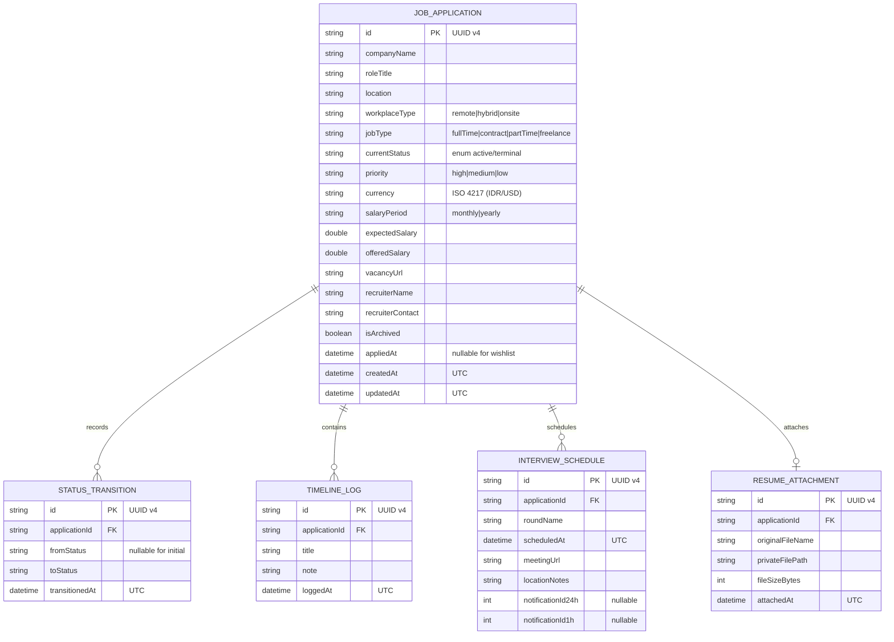

# Product Requirement Document (PRD)

## Project: ApplyFlow — Job Application & Career Pipeline Tracker
* **Document Version:** 2.0.0
* **Target Platform:** Mobile (Android API 26+ / iOS 14+)
* **Framework:** Flutter 3.24+ (Dart 3.5+)
* **Architecture:** Clean Architecture + Feature-First (Local-First Offline Application)
* **Status:** Approved for Development

---

## 1. Executive Summary & Problem Statement

### 1.1 Background
Job seekers routinely apply to 30–100+ positions across multiple channels (LinkedIn, Jobstreet, Glints, direct referrals, company portals). Managing applications via spreadsheets or generic to-do apps leads to:
* **Missed interviews & deadlines** due to unorganized schedules.
* **Loss of context** regarding which CV version was sent, who the recruiter is, or what was discussed in earlier rounds.
* **No actionable insights** on conversion rates because status changes overwrite historical progress.

### 1.2 Solution
**ApplyFlow** is an offline-first, privacy-focused Flutter mobile application to organize, track, and analyze the job search lifecycle. It separates active hiring stages from terminal outcomes, records every status transition for accurate analytics, and provides reliable local reminders.

---

## 2. Scope: MVP (v1.0) vs. Post-MVP (v1.1+)

### 2.1 MVP Scope (Rilis 1.0)
1. **Pipeline & CRUD Lamaran:** Kanban Board (tahapan aktif) + Tab/Filter hasil akhir, List View, tambah/edit/arsip/hapus lamaran.
2. **Riwayat Transisi Status:** Pencatatan otomatis setiap perpindahan status untuk akurasi metrik.
3. **Halaman Detail & Timeline:** Info lowongan, catatan kronologis, dan manajemen lampiran CV (PDF).
4. **Pengingat Interview Dasar:** Jadwal interview + notifikasi lokal (24 jam & 1 jam sebelum) dengan aturan fallback.
5. **Pencarian & Filter Dasar:** Cari berdasarkan nama perusahaan/posisi; filter berdasarkan status, prioritas, dan tipe kerja.
6. **Analitik Dasar:** Ringkasan metrik funnel (Total Applied, Interview Rate, Offer Rate, Response Velocity).
7. **Backup & Restore Dasar:** Ekspor dan impor `.json` dengan validasi skema dan konfirmasi timpa data.
8. **UX Dasar:** Onboarding singkat (3 slide), empty state, konfirmasi hapus, dukungan tema (Light/Dark/System), dan lokalisasi (ID & EN).

### 2.2 Post-MVP Scope (Rilis 1.1+)
1. **Sinkronisasi Kalender Native** (`add_2_calendar` ke Google/Apple Calendar).
2. **Chart Analitik Lanjutan** (distribusi gaji, grafik tren mingguan dengan `fl_chart`).
3. **Aksi Kontak Cepat** (shortcut WhatsApp/Email/Telepon langsung dari halaman detail).
4. **Kunci Aplikasi Biometrik/PIN** (`local_auth`).
5. **Ekspor CSV** untuk analisis di Excel/Google Sheets.
6. **Kustomisasi Tahap Pipeline** (menambah/mengubah nama kolom aktif).

---

## 3. Aturan Pipeline, Status & Transisi

### 3.1 Pemisahan Tahap Aktif vs. Hasil Akhir (Terminal Outcomes)
Pipeline tidak mencampur proses aktif dengan hasil akhir.

* **Tahapan Aktif (Ditampilkan sebagai kolom di Kanban Board):**
  1. `wishlist` — Disimpan, belum dilamar.
  2. `applied` — Lamaran sudah dikirim.
  3. `screening` — Screening CV / HR Call awal.
  4. `interview` — Technical test, user interview, atau panel interview.
  5. `offering` — Tahap negosiasi atau menunggu offering letter.

* **Hasil Akhir / Terminal Outcomes (Dipindahkan dari Kanban aktif ke tab/section "Selesai" atau filter khusus):**
  1. `offer_accepted` — Tawaran diterima.
  2. `offer_declined` — Tawaran ditolak oleh pelamar.
  3. `rejected` — Ditolak oleh perusahaan.
  4. `withdrawn` — Lamaran ditarik oleh pelamar.
  5. `no_response` — Tidak ada respon (*ghosted*) setelah melewati batas waktu tunggu.

### 3.2 Aturan Kustomisasi & Arsip
* **Kustomisasi Tahap:** Pada MVP v1.0, daftar tahapan aktif dan hasil akhir bersifat **tetap (fixed)** agar perhitungan metrik konsisten.
* **Arsip vs. Hapus:**
  * **Arsip (`isArchived = true`):** Menyembunyikan lamaran dari Kanban aktif tanpa menghapus data dari perhitungan analitik historis.
  * **Hapus Permanen:** Menghapus data lamaran, riwayat transisi, jadwal, dan file PDF lokal terkait setelah konfirmasi pengguna.

---

## 4. Definisi Metrik & Rumus Analitik

Semua metrik dihitung berdasarkan **tabel riwayat transisi status (`StatusTransition`)**, bukan hanya status terkini, sehingga lamaran yang berakhir `rejected` atau `withdrawn` tetap tercatat akurat pernah melewati tahap sebelumnya.

| Metrik | Definisi & Rumus |
| :--- | :--- |
| **Total Applied** | Jumlah unik lamaran yang **pernah** masuk ke status `applied` atau tahap setelahnya (tidak termasuk yang hanya berhenti di `wishlist`). |
| **Interview Rate** | `(Jumlah unik lamaran yang pernah mencapai status interview / Total Applied) × 100%`. |
| **Offer Rate** | `(Jumlah unik lamaran yang pernah mencapai status offering atau offer_accepted / Total Applied) × 100%`. |
| **Response Velocity** | Rata-rata durasi (dalam hari) dari timestamp pertama kali masuk `applied` hingga transisi pertama keluar dari `applied` menuju `screening`, `interview`, `offering`, atau `rejected`. *(Lamaran berstatus `no_response` atau `withdrawn` sebelum ada respon perusahaan tidak dihitung dalam rata-rata ini).* |

---

## 5. Aturan Data, Mata Uang & Lokalisasi

* **Mata Uang & Format Gaji:**
  * Mendukung kode mata uang ISO 4217 (default MVP: `IDR` dan `USD`, dapat dipilih per lamaran).
  * Setiap entri gaji wajib memiliki **periode**: `monthly` (bulanan) atau `yearly` (tahunan).
  * Format angka mengikuti locale aktif (`Rp 15.000.000` untuk ID, `$5,000` untuk EN).
* **Zona Waktu:** Semua timestamp (`createdAt`, `appliedAt`, `scheduledAt`, `transitionedAt`) disimpan dalam **UTC** di database dan dikonversi ke **zona waktu lokal perangkat** saat ditampilkan.
* **Tanggal Lamaran (`appliedAt`):** Bernilai `null` saat status masih `wishlist`. Otomatis diisi timestamp saat pertama kali berpindah ke `applied` (dapat diedit manual oleh pengguna).
* **Definisi Prioritas:**
  * `high` — Target utama / deadline dekat.
  * `medium` — Sesuai kualifikasi, prioritas standar (default).
  * `low` — Cadangan / eksplorasi.

---

## 6. Spesifikasi Fitur & Kriteria Penerimaan (Acceptance Criteria)

### 6.1 Kanban Board & Manajemen Lamaran
* **Interaksi Drag-and-Drop:** Menggunakan `LongPressDraggable` dan `DragTarget` bawaan Flutter untuk memindahkan kartu antar kolom aktif, disertai tombol cepat *"Ubah Status"* di halaman detail sebagai alternatif aksesibilitas (non-drag).
* **Kriteria Penerimaan:**
  * *Given* pengguna berada di Kanban Board, *when* kartu di-drag dari `Applied` ke `Interview`, *then* status kartu berubah menjadi `Interview`, entri baru tercatat di `StatusTransition`, dan metrik diperbarui otomatis.
  * *Given* pengguna menekan tombol Hapus pada lamaran, *when* dialog konfirmasi muncul dan pengguna memilih "Hapus", *then* lamaran beserta jadwal dan file PDF lokalnya terhapus permanen.

### 6.2 Jadwal Interview & Pengingat (Aturan Fallback)
* **Jadwal Standar:** Pengingat dijadwalkan **24 jam sebelum** dan **1 jam sebelum** `scheduledAt`.
* **Aturan Fallback:**
  1. **Dibuat < 24 jam sebelum jadwal:** Pengingat 24 jam dilewati; hanya pengingat 1 jam sebelum yang dijadwalkan. Jika dibuat < 1 jam sebelum jadwal, tidak ada alarm terjadwal dan aplikasi menampilkan banner informasi *"Jadwal kurang dari 1 jam lagi"*.
  2. **Izin notifikasi ditolak:** Jadwal tetap tersimpan di database, namun aplikasi menampilkan status *"Pengingat tidak aktif (izin notifikasi diperlukan)"* beserta tombol pintas ke pengaturan izin OS.
  3. **Jadwal diubah atau dihapus:** ID notifikasi lokal lama wajib dibatalkan (`cancel`) terlebih dahulu sebelum menjadwalkan ulang atau menghapus data.
* **Sinkronisasi Kalender (Post-MVP):** Bersifat **opsional** (tombol manual *"Tambah ke Kalender"*), mengingat perbedaan alur izin kalender di Android dan iOS.

### 6.3 Lampiran CV (PDF)
* **Penyimpanan Privat:** File PDF yang dipilih melalui `file_picker` **disalin ke direktori privat aplikasi** (`getApplicationDocumentsDirectory()/resumes/`) dengan nama unik agar tidak putus jika file asli di folder Downloads/Drive dipindahkan atau dihapus.
* **Batasan:** Maksimal **1 file PDF aktif per lamaran** pada MVP, dengan batas ukuran maksimal **10 MB**.
* **Kriteria Penerimaan:**
  * *Given* pengguna memilih file PDF > 10 MB, *then* aplikasi menolak file dan menampilkan pesan error batas ukuran.
  * *Given* file PDF di penyimpanan privat hilang atau rusak, *when* pengguna membuka halaman detail, *then* aplikasi menampilkan status *"File tidak ditemukan"* dan tombol *"Lampirkan Ulang"* tanpa crash.

### 6.4 Backup & Restore
* **Format & Lokasi:** File `.json` berisi metadata (`schemaVersion`, `exportedAt`, `appVersion`) dan seluruh tabel data. Disimpan/dibagikan melalui system file picker / share sheet.
* **Validasi & Konflik:**
  * File impor divalidasi struktur JSON dan `schemaVersion`-nya sebelum diproses.
  * Mode restore MVP: **Replace All (Timpa Semua Data)** dengan dialog konfirmasi eksplisit: *"Semua data saat ini akan diganti dengan data dari file backup. Lanjutkan?"*.
  * Peringatan privasi: Aplikasi memberi tahu pengguna bahwa file backup `.json` berisi data sensitif (kontak recruiter & catatan) dalam bentuk teks biasa (*plain JSON*).

---

## 7. Keputusan Tech Stack

| Komponen | Pilihan Final | Alasan Pemilihan |
| :--- | :--- | :--- |
| **Framework** | Flutter 3.24+ / Dart 3.5+ | Stabil, mendukung Material 3 dan Impeller. |
| **State Management** | `flutter_bloc` (v8.x) | Transisi state eksplisit, mudah di-unit-test (`bloc_test`), standar industri. |
| **Local Database** | **Drift (SQLite)** | Mendukung query relasional kompleks untuk menghitung metrik dari `StatusTransition`, migrasi skema eksplisit & aman, serta ACID compliant. |
| **Drag-and-Drop** | `LongPressDraggable` + `DragTarget` (Flutter Native) | Menghindari ketergantungan paket pihak ketiga yang sering konflik dengan scroll horizontal Kanban. |
| **PDF Viewer** | `flutter_pdfview` + `file_picker` | Ringan dan stabil untuk preview PDF lokal. |
| **Notifikasi** | `flutter_local_notifications` + `timezone` | Mendukung penjadwalan akurat lintas zona waktu di Android & iOS. |

---

## 8. Model Data (ERD)

---

## 9. Privasi, Keamanan & Kualitas UX

* **Kebijakan Backup OS:** `android:allowBackup="false"` pada AndroidManifest agar data lamaran tidak otomatis terunggah ke cloud backup OS tanpa sepengetahuan pengguna.
* **Penghapusan Data:** Tersedia tombol *"Hapus Semua Data"* di menu Pengaturan untuk membersihkan database dan seluruh file PDF di direktori privat.
* **UX & Aksesibilitas:**
  * Onboarding singkat (maksimal 3 halaman) saat pertama kali dibuka.
  * Empty state informatif di setiap tab/kolom kosong dengan CTA yang jelas.
  * Target sentuh minimal `48x48 dp`, semantic label untuk screen reader, dan rasio kontras teks memenuhi standar WCAG AA pada Light & Dark Mode.
* **Target Pengujian:** Diuji pada ukuran layar kecil (360dp width) hingga tablet, pada Android 8.0+ (API 26+) dan iOS 14+.
